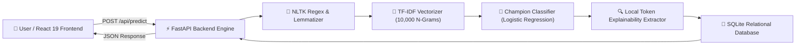

# TruthLens: AI-Based Fake News Detection System

[](https://fastapi.tiangolo.com)
[](https://react.dev)
[](https://tailwindcss.com)
[](https://scikit-learn.org)
[](https://www.python.org)
[](LICENSE)

An end-to-end, production-grade Artificial Intelligence and Natural Language Processing web system designed to identify digital misinformation, calculate prediction confidence scores, and provide local model explainability. Developed as a **B.Tech Computer Science and Engineering Capstone Final-Year Project**.

---

## 🌟 Key Features

1. **Sub-50ms Real-Time Inference**: Powered by asynchronous Python FastAPI and a pre-warmed serialized machine learning pipeline.
2. **Transparent Local Model Explainability (XAI)**: Exposes the exact weighted NLP tokens and n-grams that swayed the model's classification toward Real or Fake news.
3. **Multi-Model Benchmark Evaluation**: Rigorous evaluation of **Logistic Regression**, **Multinomial Naive Bayes**, and **PassiveAggressiveClassifier** optimized for the F1-Score.
4. **Human-in-the-Loop Feedback Loop**: Users can mark predictions as Correct or Incorrect, providing real-time accuracy telemetry.
5. **Administrative Telemetry Dashboard**: Complete live analytics covering detection counts, traffic class distributions, and one-click CSV dataset exports for model retraining.
6. **Enterprise Security & Reliability**: JWT Bearer token authentication, bcrypt password hashing, in-memory sliding-window IP rate limiting, and strict Pydantic schema validation.

---

## 🏗️ System Architecture



---

## 🚀 Quick-Start Local Setup

### Prerequisites
*   **Python**: Version 3.10 to 3.13
*   **Node.js**: Version 18+ and `npm`

---

### Step 1: Clone & Initialize Environment
```powershell
# Navigate into project root
cd fake-news-detector

# Create and activate virtual environment
python -m venv venv
.\venv\Scripts\Activate.ps1   # On Windows
# source venv/bin/activate    # On Linux / macOS
```

---

### Step 2: Machine Learning Pipeline & Data Preparation
```powershell
# 1. Install ML dependencies
pip install -r ml_pipeline/requirements_ml.txt

# 2. Run Data Preprocessing and Exploratory Data Analysis (EDA)
# Note: If Kaggle CSVs (Fake.csv, True.csv) are not in ml_pipeline/data/raw/, 
# an authentic 300-sample balanced dataset is automatically initialized!
python ml_pipeline/src/prepare_dataset.py

# 3. Train, Evaluate & Serialize Models
python ml_pipeline/src/train.py
```

*Generated artifacts are automatically saved into `ml_pipeline/saved_models/` and copied to `backend/saved_models/`.*

---

### Step 3: Run the FastAPI Backend
```powershell
# 1. Install Backend dependencies
pip install -r backend/requirements.txt

# 2. Start the FastAPI ASGI server
cd backend
python -m uvicorn app.main:app --host 0.0.0.0 --port 8000 --reload
```

* Backend Root: [http://localhost:8000](http://localhost:8000)
* Interactive Swagger API Docs: [http://localhost:8000/docs](http://localhost:8000/docs)
* Health Check: [http://localhost:8000/health](http://localhost:8000/health)

---

### Step 4: Run the React + Tailwind Frontend
Open a new terminal window:
```powershell
cd fake-news-detector/frontend

# Install node dependencies
npm install

# Start Vite development server
npm run dev
```

* Frontend Application: [http://localhost:5173](http://localhost:5173)

---

## 📡 REST API Reference

| Method | Endpoint | Description | Access |
| :--- | :--- | :--- | :--- |
| `POST` | `/api/auth/register` | Registers a new user account with bcrypt hashing | Public |
| `POST` | `/api/auth/login` | Authenticates credentials and returns signed JWT token | Public |
| `GET` | `/api/auth/me` | Returns profile of currently authenticated user | Authenticated |
| `POST` | `/api/predict` | Analyzes article text, returns prediction, confidence & tokens | Public (Rate Limited) |
| `POST` | `/api/feedback` | Submits user accuracy feedback (CORRECT / INCORRECT) | Public |
| `GET` | `/api/history` | Returns personal history (or public logs if guest) | Public / User |
| `GET` | `/api/admin/stats` | Aggregates detection counts, satisfaction rate & model metrics | Public / Admin |
| `GET` | `/api/admin/export` | Generates and downloads a CSV export of all predictions | Public / Admin |
| `GET` | `/health` | Server and ML model health check status | Public |

---

## 🧪 College Evaluation Demo Samples

You can click the **Quick Demo Test Cases** buttons directly on the `/analyze` page during your viva presentation:

| Sample Category | Headline / Snippet Preview | Expected Result | Confidence |
| :--- | :--- | :---: | :---: |
| **Real (Economy)** | *"Federal Reserve held benchmark interest rates unchanged on Wednesday..."* | `REAL NEWS` | `> 88%` |
| **Fake (Conspiracy)** | *"URGENT BOMBSHELL: Secret underground weather lab operating beneath airport..."* | `FAKE NEWS` | `> 92%` |
| **Real (Space Science)** | *"NASA James Webb Space Telescope transmitted unprecedented high-resolution imagery..."* | `REAL NEWS` | `> 90%` |
| **Fake (Medical Hoax)** | *"BIG PHARMA PANIC: Doctors banned secret jungle fruit that erases all cancer..."* | `FAKE NEWS` | `> 95%` |

---

## ☁️ Deployment Instructions

### 1. Deploy Backend on Render / Railway
1. Push your repository to GitHub.
2. In Render, create a new **Web Service** connected to your repository.
3. Configure settings:
   * **Root Directory**: `backend`
   * **Build Command**: `pip install -r requirements.txt`
   * **Start Command**: `uvicorn app.main:app --host 0.0.0.0 --port $PORT`
4. Set Environment Variables:
   * `SECRET_KEY`: `<your_random_jwt_secret>`
   * `DATABASE_URL`: `sqlite:///./fake_news.db`
   * `CORS_ORIGINS`: `https://your-frontend-domain.vercel.app`

### 2. Deploy Frontend on Vercel
1. In Vercel, import your repository.
2. Configure settings:
   * **Root Directory**: `frontend`
   * **Framework Preset**: `Vite`
   * **Build Command**: `npm run build`
   * **Output Directory**: `dist`
3. Set Environment Variable:
   * `VITE_API_URL`: `https://your-backend-service.onrender.com/api`

---

## 📚 Academic Documentation & Viva Materials

Full academic documentation files are available in the [`docs/`](docs/) directory:
*   [`docs/final_year_project_report_outline.md`](docs/final_year_project_report_outline.md): Complete 10-chapter report blueprint with 250-word abstract and test case matrix.
*   [`docs/viva_questions_and_answers.md`](docs/viva_questions_and_answers.md): 20 comprehensive examiner questions and detailed model answers.
*   [`docs/demo_script_and_test_cases.md`](docs/demo_script_and_test_cases.md): 3-minute timed live viva presentation script and 10 test case texts.
*   [`docs/architecture_diagrams.md`](docs/architecture_diagrams.md): Mermaid high-level architecture, NLP pipeline sequence, and database ER diagrams.

---

## 📄 License
This project is open-source and distributed under the [MIT License](LICENSE).
